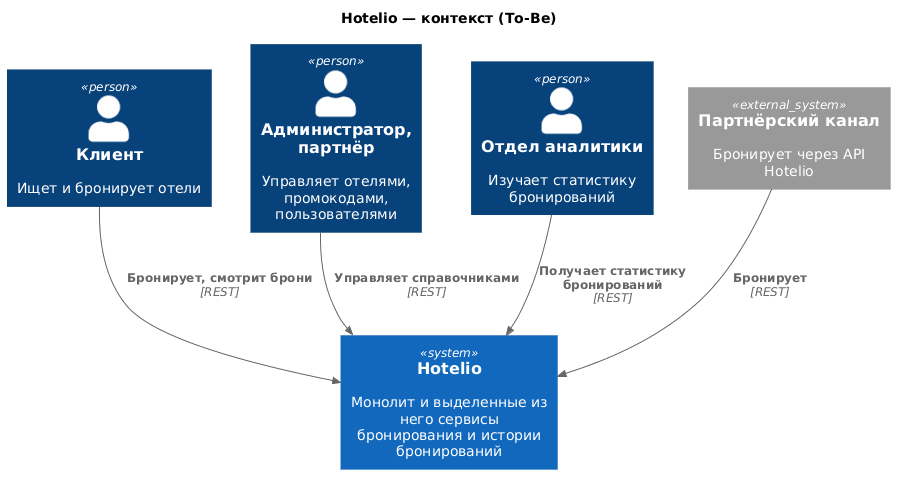
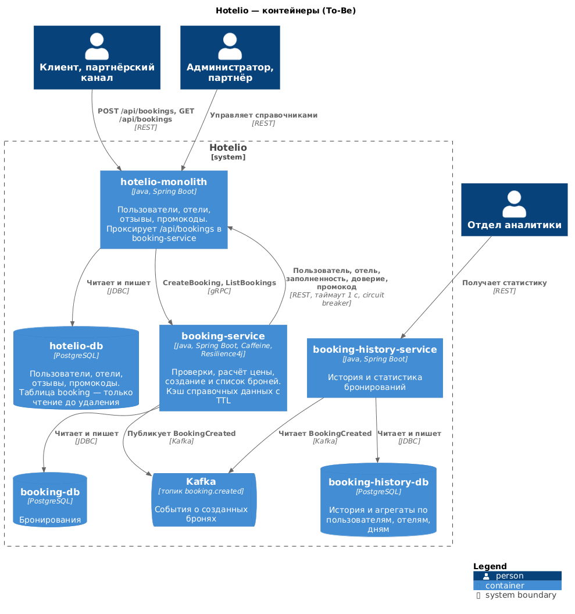

### **Название задачи:** Начало миграции Hotelio с монолита на микросервисы: вынос BookingService

### **Автор:** Mikhail Khorsun

### **Дата:** 2026-11-03

### **Функциональные требования**

| **№** | **Действующие лица или системы** | **Use Case** | **Описание** |
| :-: | :- | :- | :- |
| 1 | Клиент, партнёрский канал | Создать бронирование | 1. Клиент вызывает `POST /api/bookings` монолита. 2. Монолит проксирует запрос в `booking-service` через gRPC `CreateBooking`. 3. `booking-service` получает данные пользователя, отеля, отзывов и промокода. 4. Проверяет: пользователь активен и не в чёрном списке, отель работает, ему доверяют, есть места. 5. Считает цену и скидку, сохраняет бронирование в своей БД. 6. Публикует событие `BookingCreated` в Kafka. 7. Возвращает бронирование клиенту. |
| 2 | Клиент, партнёрский канал | Посмотреть бронирования | 1. Клиент вызывает `GET /api/bookings` (с `userId` или без). 2. Монолит проксирует запрос в `booking-service` через gRPC `ListBookings`. 3. `booking-service` возвращает бронирования из своей БД. |
| 3 | Отдел аналитики | Получить статистику бронирований | 1. `booking-history-service` читает `BookingCreated` из Kafka. 2. Сохраняет историю и считает агрегаты по пользователям, отелям и дням в своей БД. 3. Аналитики получают статистику без доступа к боевой БД. |
| 4 | Администратор, партнёр | Управлять пользователями, отелями, промокодами, отзывами | Функциональность остаётся в монолите без изменений. |

### **Нефункциональные требования**

| **№** | **Требование** |
| :-: | :- |
| 1 | `booking-service` масштабируется горизонтально и независимо от монолита. |
| 2 | Внешний контракт `/api/bookings` не меняется: те же пути, параметры, поля ответа и коды ошибок. |
| 3 | Регрессионные тесты (`test/regress.sh`) дают одинаковый результат до и после переключения. |
| 4 | Время создания бронирования при деградации монолита — не более ~2 с: запросы к монолиту идут параллельно, таймаут 1 с, один повтор. *Допущение: метрик нет, значение уточняется по замерам.* |
| 5 | Нагрузка `booking-service` на монолит в пик ограничена: справочные данные читаются из кэша. |
| 6 | Допустимая неактуальность данных: пользователь — 5 мин, отель — 1 ч, заполненность отеля — 1 мин, доверие к отелю — 1 ч. |
| 7 | `booking-service` и `booking-history-service` используют собственные БД (начало разделения баз). |
| 8 | Аналитика не создаёт нагрузку на боевую БД бронирований. |
| 9 | Переключение на `booking-service` и откат выполняются конфигурацией монолита, без пересборки. |
| 10 | Для `booking-service` собираются метрики: время ответа монолита, попадания в кэш, использование устаревших данных, состояние circuit breaker. |

### **Решение**

#### Проблемы

Проблемы, заявленные бизнесом: сложность сопровождения, невозможность масштабировать отдельный компонент, зависимость команд друг от друга, универсальный REST без BFF, риск ошибок при запуске фич.

Найдены при анализе кода и проверены на запущенном приложении:

| № | Проблема | Почему важно для миграции |
| :-: | :- | :- |
| 1 | Создание брони делает 8 вызовов других модулей. Их скрывает кэш сессии JPA: в БД уходит только 5 запросов | При переносе как есть получится 8 сетевых вызовов на одну бронь |
| 2 | `createdAt` у бронирования не заполняется | Аналитике нужна статистика по дням |
| 3 | `ddl-auto: create` пересоздаёт схему при каждом старте | Перезапуск монолита стирает все данные, в том числе во время миграции |
| 4 | Скидка вычитается как абсолютное значение, хотя поле называется `discountPercent` | Перенос «как есть» сохраняет ошибку, исправление меняет цены |
| 5 | Цена зашита в коде (100 / 80 для VIP) и не зависит от отеля | Ограничение бизнес-логики |
| 6 | `validUntil` промокода не проверяется, неверный промокод молча даёт 0% и сохраняется в брони | Финансовые потери и непрозрачность для клиента |
| 7 | Два теста бронирования проходят не по той причине: проверка `fullyBooked` не покрыта | Тесты должны защищать миграцию |
| 8 | Все бизнес-ошибки возвращают 500, регрессионные тесты ожидают именно 500 | Новый сервис должен сохранить этот контракт |
| 9 | Нет транзакций и авторизации: `userId` берётся из параметра запроса | Риск безопасности, к нему вернёмся в задании 3 (ACL) |
| 10 | Прокси монолита направляет в gRPC не только создание, но и список бронирований | Без переноса данных старые брони пропадут из ответа, тесты списка упадут |

#### Какой модуль выносим первым

**BookingService.**

- На бронирование приходятся пиковые нагрузки (из условия; *допущение — метрик нет*). После выноса его можно масштабировать отдельно.
- Внутри монолита его никто не вызывает. Это упрощает переключение по Strangler Fig: достаточно подменить одну точку входа.
- Это не самый простой модуль: у него больше всего исходящих зависимостей (4). Технически проще вынести `ReviewService`, но он не решает проблему пиков и почти не приближает цели бизнеса.
- На бронированиях строится новая функциональность (аналитика). По условию новые фичи пишутся только в мигрированных сервисах.

#### Взаимодействие booking-service с монолитом

Данные для проверок берутся через уже существующий REST монолита, код монолита не дорабатывается. Вместо 8 вызовов достаточно 5, все они идут параллельно:

| Запрос | Данные | Кэш (TTL) | Монолит недоступен, TTL истёк | Монолит недоступен, данных нет |
| :- | :- | :- | :- | :- |
| `GET /api/users/{id}` | `status`, `active`, `blacklisted` | 5 мин | Отказ | Отказ |
| `GET /api/hotels/{id}` | `operational` | 1 ч | Последнее известное значение, не старше 24 ч | Отказ |
| `GET /api/hotels/{id}/fully-booked` | `fullyBooked` | 1 мин | Последнее известное значение, не старше 24 ч | Отказ |
| `GET /api/reviews/hotel/{id}/trusted` | доверие к отелю | 1 ч | Последнее известное значение, не старше 24 ч | Отказ |
| `POST /api/promos/validate` | скидка | Не кэшируется | — | Скидка 0%, промокод не применяется |

Почему так:

- **Пользователь.** Чёрный список — вопрос безопасности, поэтому устаревшие данные дольше 5 минут не используются.
- **Отель и доверие.** Меняются редко. Если монолит упал, лучше продолжить продажи по вчерашним данным, чем остановить их. Срок 24 ч ограничивает риск продажи в отель, который за это время закрыли.
- **Заполненность отдельно от отеля.** У монолита есть отдельный `GET /api/hotels/{id}/fully-booked`. Флаг «мест нет» меняется часто, а работает ли отель — редко. Один общий TTL заставил бы выбирать между частыми запросами за статичными данными и часом продаж в заполненный отель. Лишний запрос стоит дёшево: не больше одного в минуту на отель.
- **Промокод.** Ответ зависит от пары «промокод + пользователь» и влияет на деньги, поэтому не кэшируется.

Правила вызовов:

- Кэш используется всегда: в монолит идём только по истечении TTL. Так кэш снижает нагрузку в пик, а не только страхует от сбоев.
- Таймаут 1 с, один повтор — только на быстрые ошибки (обрыв соединения, 503) и со случайной паузой. После таймаута не повторяем, чтобы не устроить шквал повторов.
- Circuit breaker: при серии ошибок временно не обращаемся к монолиту и сразу берём запасной вариант из таблицы.
- Пока одна загрузка ключа идёт, остальные запросы к тому же ключу ждут её результат, а не идут в монолит параллельно.
- Инвалидации по событиям на этом этапе нет: монолит не умеет сообщать об изменениях. Неактуальность ограничена TTL. Инвалидация по событиям — в плане развития, когда User и Hotel станут отдельными сервисами.

#### Неприменённый промокод

Если промокод невалиден или его не удалось проверить, бронь создаётся со скидкой 0%, а промокод в неё **не сохраняется**. Клиент видит в ответе пустой `promoCode` и нулевую скидку — это и есть явный сигнал, что промокод не применён.

Новое поле статуса промокода на этом этапе не добавляется. Ответ клиенту формирует прокси монолита, а он знает только текущие поля `booking.proto`, поэтому новое поле до клиента не дойдёт без доработки монолита. Поле `promo_status` добавим вместе с BFF, когда ответ клиенту будет формировать новый сервис.

#### Перенос поведения

Бизнес-правила переносятся **1:1**: базовая цена 100 / 80 для VIP, вычитание скидки как абсолютного значения, порядок проверок, код 500 на любую бизнес-ошибку. Цель первого шага — перенести, а не исправить: так регрессионные тесты подтверждают, что сервис ведёт себя как монолит, а клиенты не видят изменения цен.

Исключения — только изменения, которые не ломают контракт:

- `createdAt` заполняется: поле уже есть в контракте, оно нужно аналитике.
- Неприменённый промокод не сохраняется (см. выше): ни один тест на это не опирается.

Исправление скидки, проверка `validUntil` и осмысленные коды ошибок (400, 404, 409) — отдельные задачи после стабилизации, каждая со своим согласованием с бизнесом.

#### Асинхронное взаимодействие

- `booking-service` публикует `BookingCreated` в один топик `booking.created`. Ключ — `bookingId`.
- Событие отправляется после сохранения брони. Если отправка не удалась, бронь остаётся, ошибка пишется в лог и метрику. Потеря отдельных событий для аналитики на этом этапе допустима. Если станет недопустима — transactional outbox.
- `booking-history-service` читает события и строит статистику в своей БД. Обработка идемпотентна по `bookingId`, поэтому повторная доставка не искажает статистику.

#### Технологии

- `booking-service`, `booking-history-service`: Java 17, Spring Boot — основной стек команды.
- Монолит ↔ `booking-service`: gRPC по контракту `booking.proto` (задано условием).
- `booking-service` → монолит: REST (задано условием), Resilience4j для таймаутов, повторов и circuit breaker.
- Кэш: локальный в каждом экземпляре (Caffeine). Общий кэш (Redis) — это ещё один компонент, который нужно поднимать и сопровождать; команда маленькая, а данных в кэше мало. Цена — каждый экземпляр сам ходит в монолит: при N экземплярах нагрузка от кэша в N раз выше, но это единицы запросов в минуту на отель. Redis рассмотрим, если экземпляров станет много.
- События: Kafka — уже есть в инфраструктуре.
- БД: отдельный PostgreSQL для каждого нового сервиса.

#### Диаграммы C4

Исходники: [c4-context.puml](c4-context.puml), [c4-container.puml](c4-container.puml).

**Контекст**

**Контейнеры**

#### Стратегия данных

- `booking-service` владеет бронированиями и хранит их в своей БД `booking-db`. Монолит после переключения в таблицу `booking` не пишет.
- Существующие брони переносятся в `booking-db` с сохранением `id`. Счётчик `id` в новой БД начинается с запасом выше максимального `id` старой таблицы, чтобы новые брони не конфликтовали с переносимыми.
- Перенос в два прохода: основной до переключения, догоняющий (`id` больше последнего перенесённого) сразу после. Так брони, созданные в момент переключения, не теряются.
- Старая таблица `booking` остаётся только для чтения на время стабилизации, затем удаляется.
- `booking-history-service` считает статистику с момента переключения. Старые брони в историю не переносятся: у них нет `createdAt`, статистику по дням из них не построить.
- Предусловие: в монолите `ddl-auto` переключается с `create` на `update` переменной окружения. Иначе любой перезапуск монолита во время миграции сотрёт данные. `validate` не подходит: на пустой БД монолит не стартует, а инструмента миграций схемы у монолита нет.

#### План миграции (Strangler Fig)

1. **Подготовка.** Отключить пересоздание схемы монолита (`SPRING_JPA_HIBERNATE_DDL_AUTO=update`). Дописать в регрессионные тесты проверку `fullyBooked` на работающем доверенном отеле.
2. **Развёртывание.** Поднять `booking-service`, `booking-db`, Kafka и `booking-history-service`. Трафика на них ещё нет.
3. **Основной перенос данных** из `booking` в `booking-db`.
4. **Переключение.** Задать монолиту `BOOKING_SERVICE_EXTERNAL_HOST` и `BOOKING_SERVICE_EXTERNAL_PORT`, перезапустить.
5. **Догоняющий перенос** броней, созданных до переключения.
6. **Проверка.** Регрессионные тесты, метрики ошибок и времени ответа.
7. **Откат при проблемах.** Убрать переменные и перезапустить монолит. Брони, созданные в `booking-service`, скопировать обратно в `booking` тем же скриптом в обратную сторону.
8. **Стабилизация.** После 2 недель без откатов удалить `BookingService` из монолита и таблицу `booking`.
9. **Дальше.** Выносить `ReviewService`, `HotelService`, `PromoCodeService`, `AppUserService`. После выноса User и Hotel заменить TTL на инвалидацию по событиям, а флаг `fullyBooked` — расчётом заполненности в `booking-service`, который владеет бронированиями.

### **Альтернативы**

| Альтернатива | Почему не выбрана |
| :- | :- |
| Начать с `ReviewService` | Проще технически, но не решает проблему пиков и не приближает цели бизнеса |
| Проверки через Kafka (запрос в топик, ответ позже) | Бронированию ответ нужен сразу. Ответ из топика требует отдельных топиков для ответов и сопоставления запросов. Нагрузку на монолит не снижает. Требует доработки монолита, что запрещено условием |
| Асинхронное бронирование: заявка `PENDING`, подтверждение позже | Хорошо переживает пики, но меняет контракт API. Отложено |
| Ходить в монолит при каждом бронировании, кэш только при ошибке | Не снижает нагрузку в пик |
| Один TTL на весь `GET /api/hotels/{id}`, включая `fullyBooked` | Либо час продаж в заполненный отель, либо частые запросы за редко меняющимися данными |
| Общий кэш в Redis | Новый компонент инфраструктуры для маленькой команды при небольшом объёме данных |
| Инвалидация кэша по событиям | Требует доработки монолита. Перенесено в план развития |
| Поле `promo_status` в `booking.proto` сейчас | Не доходит до клиента без доработки прокси монолита. Перенесено к BFF |
| Сразу исправить скидку, `validUntil` и коды ошибок | Меняет цены и контракт, ломает регрессионные тесты. Не даёт проверить, что перенос корректен |
| Общая БД с монолитом | Быстрее старт, но сохраняет связность через данные и не даёт разделить базы |

**Недостатки, ограничения, риски**

| Риск | Последствие | Как снижаем |
| :- | :- | :- |
| `booking-service` не может быть доступнее монолита | Без монолита и без свежего кэша пользователя брони не создаются | Осознанная цена этапа. Снимается выносом User |
| Неактуальные данные в пределах TTL | Пользователь из чёрного списка бронирует до 5 мин; бронь в заполненный отель — до 1 мин | Принято. TTL уменьшаем после замеров |
| Работа на устаревших данных при недоступном монолите | До 24 ч продаж в отель, который закрыли или перестали считать доверенным | Метрика и алерт на использование устаревших данных |
| После перезапуска сервиса кэш пустой | Всплеск запросов к монолиту | Ленивая загрузка с объединением одинаковых запросов, перезапуск экземпляров по одному, circuit breaker. Прогрев при старте не делаем: он сам создаёт всплеск |
| Локальный кэш в каждом экземпляре | Экземпляры видят разные данные в пределах TTL, нагрузка на монолит растёт с числом экземпляров | Принято при текущем масштабе |
| Перегрузка монолита повторами | Каскадный отказ | Повтор только на быстрые ошибки, circuit breaker |
| Переключение и откат при живом трафике | Брони, созданные в окне переключения, теряются из списка | Догоняющий перенос; при откате — обратное копирование |
| Потеря события после сохранения брони | Неполная статистика | Лог и метрика. При необходимости — transactional outbox |
| Перенос ошибок монолита 1:1 | Сохраняются абсолютная скидка, 500 на все ошибки, игнорирование `validUntil` | Осознанно: отдельные задачи после стабилизации |
| Предположение о маппинге прокси | Если прокси иначе обрабатывает пустой `promo_code`, клиент не увидит сигнала | Проверить в задании 2 на живом прокси |
