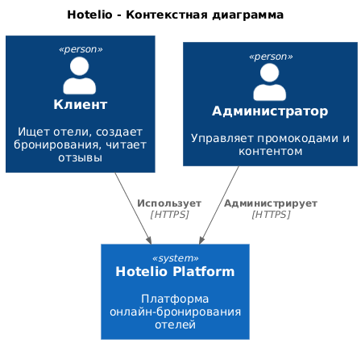
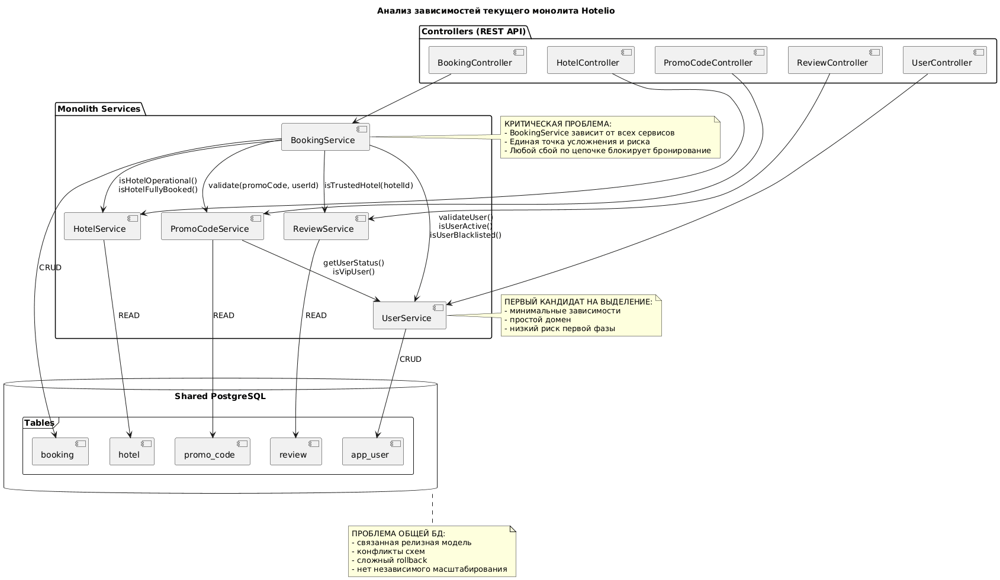
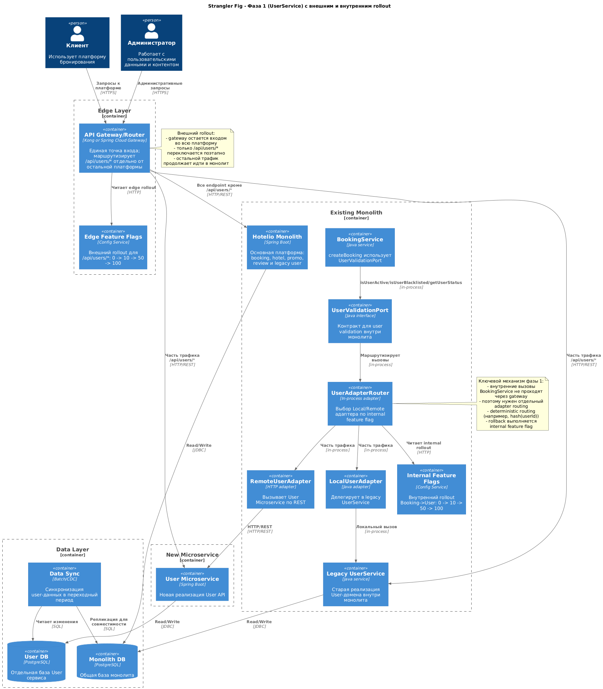
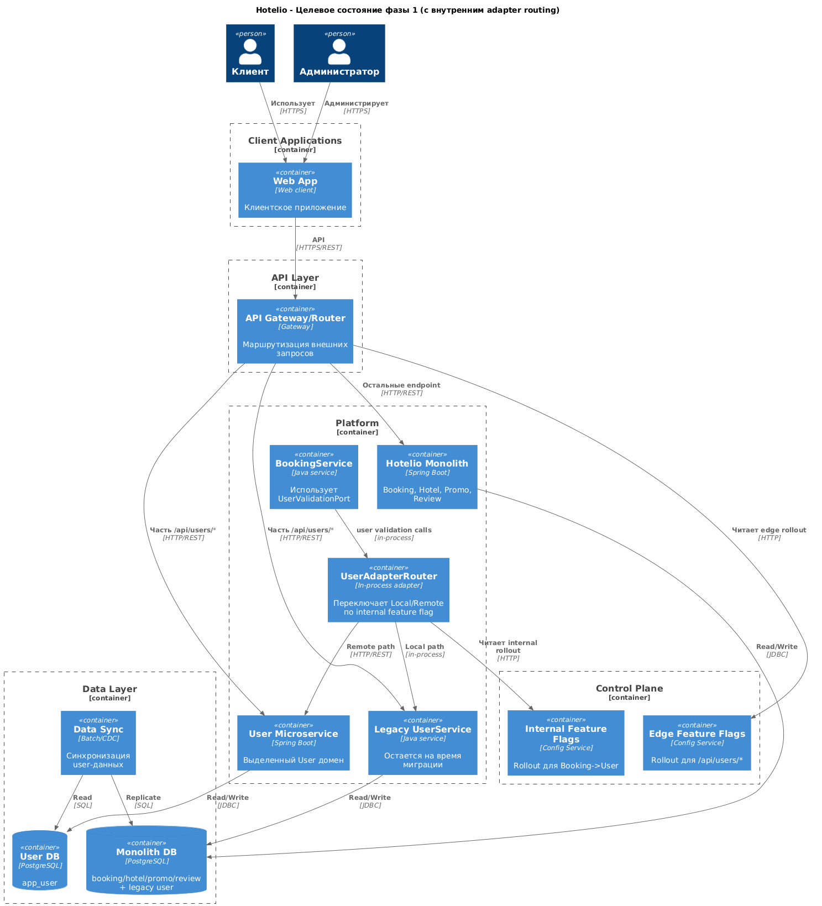
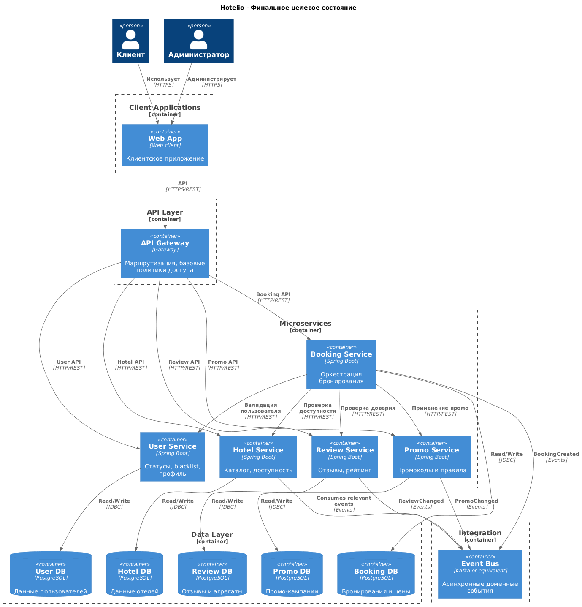

# ADR: Поэтапная миграция Hotelio от монолита к микросервисам

### Название задачи
Поэтапная миграция монолитного приложения Hotelio к микросервисной архитектуре с применением паттерна Strangler Fig

### Автор
Александр Никитин

### Дата
2026-07-18

### Функциональные требования

|**№**|**Действующие лица или системы**|**Use Case**|**Описание**|
|:-:|:-|:-|:-|
|1|Пользователь|Поиск отелей|Клиент запрашивает список отелей по городу, получает карточки отелей с ценой, рейтингом и дополнительной информацией для выбора варианта размещения.|
|2|Пользователь|Создание бронирования|Клиент выбирает отель, передает userId, hotelId и опциональный promoCode. Система валидирует пользователя, статус отеля и промокод, рассчитывает итоговую цену и сохраняет бронирование.|
|3|Пользователь|Просмотр отзывов|Клиент запрашивает отзывы по отелю, чтобы оценить качество и принять решение о бронировании.|
|4|Система|Валидация пользователя при бронировании|Во время создания бронирования система проверяет, активен ли пользователь, не находится ли он в blacklist, а также определяет его статус для расчета цены.|
|5|Система|Валидация отеля при бронировании|Система проверяет, что отель работает, не fully booked и проходит проверку доверия по отзывам.|
|6|Система|Проверка промокода|Если клиент передал промокод, система проверяет его валидность и применимость к конкретному пользователю.|
|7|Администратор|Управление пользовательскими данными|Администратор или внутренняя система должны иметь возможность получать сведения о пользователе и его статусе через API User-домена.|
|8|Внешние клиенты и внутренние компоненты|Совместимый доступ к User API в период миграции|Во время миграции внешний трафик к /api/users/* и внутренние вызовы из BookingService должны продолжать работать без изменения бизнес-поведения.|

### Нефункциональные требования

|**№**|**Требование**|
|:-:|:-|
|1|**Масштабируемость**: модули должны иметь возможность независимого масштабирования по мере выделения из монолита.|
|2|**Отказоустойчивость**: миграция не должна приводить к простою платформы; переключение между старой и новой реализациями должно быть обратимым.|
|3|**Совместимость API**: внешние контракты API должны сохраняться во время миграции без обязательных изменений для клиентов.|
|4|**Низкий риск первой итерации**: первый выделяемый модуль должен иметь минимальную связанность и минимальные бизнес-риски.|
|5|**Наблюдаемость**: для этапов переключения должны быть доступны базовые метрики ошибок, latency и доли трафика.|
|6|**Управляемый rollout**: архитектура должна позволять постепенно переключать внешний и внутренний трафик.|
|7|**Целостность данных**: во время переходного периода должен существовать понятный механизм синхронизации user-данных между старой и новой схемой владения.|
|8|**Скорость изменений**: целевая архитектура должна уменьшать связанность и упрощать дальнейшее развитие доменных модулей.|

### Решение

#### Контекст

Система Hotelio сейчас реализована как монолит на Spring Boot с общей PostgreSQL БД. Внутри монолита находятся ключевые доменные модули:
- BookingService
- AppUserService
- HotelService
- PromoCodeService
- ReviewService

Критический сценарий проходит через создание бронирования. По коду видно, что BookingService при выполнении createBooking последовательно вызывает пользовательские, отельные, review- и promo-проверки. Это делает BookingService центром связности и усложняет безопасное масштабирование или выделение сервисов.

Основные проблемы текущего состояния:
- BookingService зависит от нескольких доменных компонентов и содержит orchestration-логику.
- Все модули используют общую БД, что мешает независимым изменениям схемы и релизам.
- Внутренние вызовы выполняются напрямую в памяти процесса, поэтому edge-маршрутизация через gateway не покрывает внутренний поток вызовов.
- Любая миграция без дополнительного адаптерного слоя приведет к схеме "либо старый локальный вызов, либо полный переход на HTTP".

#### Диаграммы текущего и целевого состояния

Контекстная диаграмма:

Диаграмма зависимостей текущего монолита:

Диаграмма Strangler Fig для фазы 1:

Контейнерная диаграмма для фазы 1:

Контейнерная диаграмма финального состояния:

#### Выбранное решение

В качестве стратегии миграции выбран Strangler Fig с первым выделением UserService.

Причины выбора именно UserService:
- модуль почти не зависит от других доменных компонентов;
- его предметная область четкая и небольшая;
- он подходит для первой итерации с ограниченными ресурсами;
- его можно вынести с сохранением внешнего API;
- на нем можно безопасно отработать шаблон миграции для следующих сервисов.

#### Логика архитектурного решения для фазы 1

Фаза 1 строится вокруг двух независимых потоков трафика.

Первый поток:
- внешний трафик к /api/users/*;
- он может постепенно переключаться через API Gateway/Router.

Второй поток:
- внутренние вызовы BookingService к пользовательской логике;
- он не проходит через API Gateway, потому что сейчас BookingService обращается к AppUserService напрямую через вызовы методов.

Из этого следует ключевое решение фазы 1:
внутри монолита вводится дополнительный слой абстракции:
- UserAdapterRouter;
- LocalUserAdapter;
- RemoteUserAdapter.

Назначение компонентов:
- LocalUserAdapter делегирует вызовы в legacy AppUserService;
- RemoteUserAdapter вызывает новый User Microservice по HTTP/REST;
- UserAdapterRouter выбирает, какой адаптер использовать, на основе internal feature flag и deterministic routing.

Это позволяет мигрировать не только внешний user-трафик, но и внутреннюю зависимость BookingService от User-домена по схеме 0% -> 10% -> 50% -> 100%.

#### Технологические и организационные решения

На первой фазе используются только минимально необходимые механизмы:
- API Gateway или router для внешнего rollout;
- feature flags для управления внешним и внутренним переключением;
- отдельная User DB;
- временная синхронизация данных между User DB и монолитной БД;
- HTTP/REST для взаимодействия BookingService с новым User Microservice.

Сложные элементы инфраструктуры не делаются обязательными на первой фазе:
- event bus не требуется для старта миграции UserService;
- полная сервисная mesh-модель не требуется;
- advanced observability может быть отложена, если есть базовые метрики и возможность rollback.

#### План миграции по фазам

##### Фаза 1: UserService
1. Создать User Microservice с API-совместимостью для /api/users/*.
2. Поднять User DB и выполнить первичную загрузку user-данных.
3. Добавить в монолит адаптерный роутер.
4. Настроить edge rollout для внешнего трафика /api/users/*.
5. Настроить internal rollout для вызовов BookingService -> UserAdapterRouter.
6. Переключать внешний трафик по шагам 0% -> 10% -> 50% -> 100%.
7. После стабилизации edge-потока переключать внутренний поток Booking -> User по тем же этапам.
8. После достижения 100% внешнего и внутреннего трафика удалить legacy AppUserService из критического пути.

Критерии выхода из фазы 1:
- 100% внешнего user-трафика обслуживается User Microservice;
- 100% внутренних user-вызовов из BookingService идут через RemoteUserAdapter;
- расхождения user-данных не выявляются по контрольным сверкам;
- rollback проверен и выполняется переключением флагов;
- бизнес-поведение createBooking не меняется для клиента.

##### Фаза 2: HotelService
- Выделение HotelService в отдельный сервис.
- Повторное использование подхода с контрактом, данными и поэтапным rollout.
- Возможен более простой переход, так как шаблон фазы 1 уже отработан.

##### Фаза 3: ReviewService
- Выделение ReviewService.
- При необходимости ввод асинхронных событий для публикации изменений рейтинга и доверия.

##### Фаза 4: PromoCodeService
- Выделение PromoCodeService и логики применимости промокодов.
- Подготовка к ослаблению связности BookingService.

##### Фаза 5: BookingService
- Выделение самого сложного домена.
- Перенос orchestration-логики бронирования в отдельный сервис после стабилизации зависимостей.

#### Стратегия данных для фазы 1

Во время фазы 1 User-домен получает собственную БД, но совместимость со старым кодом все еще нужна.

Поэтому принимается временный подход:
- новый User Microservice становится основным владельцем user-логики;
- данные синхронизируются между User DB и монолитной БД;
- используются контрольные сверки целостности;
- при необходимости дальнейшие фазы могут перейти на CDC вместо более простого batch-подхода.

#### Стратегия rollout и rollback

Используются два независимых контура управления:
- edge flags для внешнего трафика /api/users/*;
- internal flags для внутренних вызовов BookingService -> UserAdapterRouter.

Rollback:
1. внешний трафик возвращается на legacy реализацию;
2. внутренний роутер переводится на LocalUserAdapter;
3. запись в новый сервис приостанавливается;
4. выполняется сверка данных и анализ причины.

Deterministic routing обязателен для внутреннего трафика:
- например, по hash(userId);
- это нужно, чтобы в рамках одного бизнес-сценария проверки active, blacklisted и status не читались из разных источников случайным образом.

### Альтернативы

#### Альтернатива 1: Big Bang Migration
Полная миграция всех доменов сразу.

Плюсы:
- не нужен долгий переходный слой.

Минусы:
- крайне высокий риск;
- почти отсутствует безопасный rollback;
- большая нагрузка на команду;
- сложно локализовать ошибки.

Решение: отклонена.

#### Альтернатива 2: Сначала разделить БД, потом код
Сначала декомпозировать общую БД.

Плюсы:
- раннее выделение границ владения данными.

Минусы:
- сложная консистентность;
- высокий риск distributed transaction-подобных проблем;
- слабый быстрый эффект для бизнеса.

Решение: отклонена.

### Недостатки, ограничения, риски

#### Недостатки
- На переходном этапе появляются и старая, и новая реализации User-домена.
- Увеличивается сложность эксплуатации из-за feature flags, адаптеров и синхронизации данных.
- Появляется сетевой overhead для внутренних вызовов из BookingService в User Microservice.

#### Ограничения
- Ресурсы команды ограничены, поэтому миграция должна идти поэтапно.
- Нельзя сразу переписать весь внутренний поток бронирования.
- Часть переходной архитектуры будет временной и технически неидеальной.

#### Риски
- Расхождение данных между User DB и монолитной БД.
- Рост latency при переходе от локального вызова к HTTP.
- Ошибки в rollout-логике могут привести к нестабильному поведению createBooking.
- Если не использовать deterministic routing, один сценарий бронирования может читать user-состояние из разных источников.

#### Снижение рисков
- Контрактные тесты между legacy User API и новым User Microservice.
- Поэтапный rollout отдельно для внешнего и внутреннего трафика.
- Контрольные сверки данных и проверенный rollback.
- Временное сохранение LocalUserAdapter до полной стабилизации.

### Критерии успешности решения

- Внешний контракт User API сохранен.
- Внутренние вызовы BookingService переведены на новый сервис без Big Bang.
- Команда получает повторяемый migration-pattern для следующих фаз.
- После завершения фазы 1 связность монолита уменьшается не только на уровне endpoint, но и на уровне внутренней бизнес-логики.