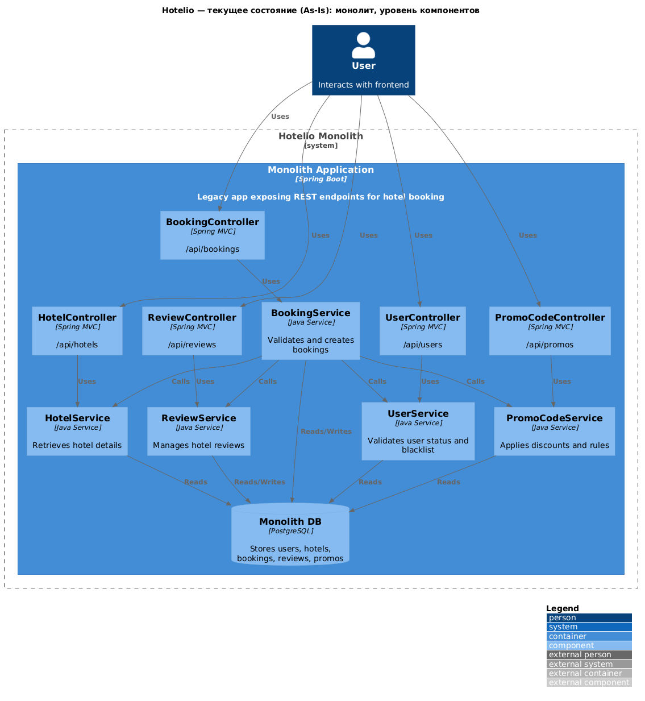
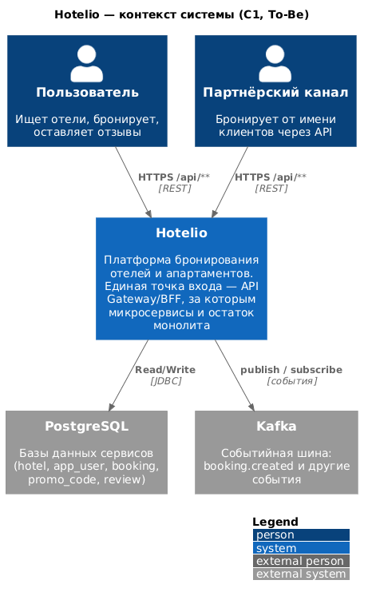
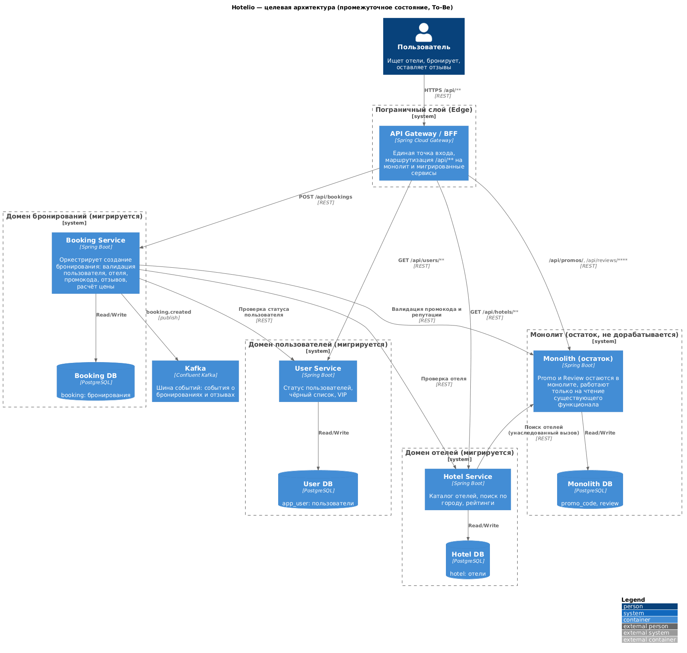

### **Название задачи:** Проработка миграции от монолита к микросервисам (Hotelio)
### **Цель задания:** подготовить архитектурный анализ и план начала миграции на микросервисы
### **Автор:** Архитектор
### **Дата:** 2026-08-30

### **Функциональные требования**

Верхнеуровневые Use Cases системы Hotelio (платформа бронирования отелей, ~1 млн пользователей). Основной трафик - поиск и бронирование жилья. Ниже - ключевые Use Cases, которые должны сохранить своё поведение после миграции.

|**№**|**Действующие лица или системы**|**Use Case**|**Описание**|
| :-: | :- | :- | :- |
|UC-1|Пользователь|Поиск отелей|Пользователь находит отели: просмотр по ID, поиск по городу (`GET /api/hotels/by-city`), топ по рейтингу (`GET /api/hotels/top-rated`). Сейчас это делает `HotelService` в монолите.|
|UC-2|Пользователь|Создание бронирования|Пользователь бронирует отель (`POST /api/bookings`). `BookingService` выполняет цепочку проверок: статус пользователя => работоспособность отеля => репутация (отзывы) => промокод => расчёт цены и скидки => запись брони.|
|UC-3|Пользователь|Просмотр статуса профиля|Пользователь получает данные и статус профиля: активен ли, в чёрном списке, авторизован, VIP (`GET /api/users/**`). Обрабатывает `AppUserService`.|
|UC-4|Пользователь|Применение промокода|Пользователь применяет промокод при бронировании; система проверяет срок действия, VIP-ограничения и применимость к пользователю (`GET/POST /api/promos/**`). Обрабатывает `PromoCodeService`.|
|UC-5|Пользователь|Оценка отеля отзывами|Пользователь смотрит отзывы об отеле и его рейтинг; система определяет «доверенный отель» (`GET /api/reviews/hotel/**`). Обрабатывает `ReviewService`, влияет на возможность бронирования.|
|UC-6|Пользователь, партнёрские каналы|Доступ к API из разных клиентов|Клиенты и партнёры обращаются к системе через единый REST API `/api/**`. После миграции контракты API должны сохраниться (единая точка входа).|

### **Нефункциональные требования**

Архитектурно значимые требования (категории R - runtime и P - проектирование).

|**№**|**Требование**|
| :-: | :- |
|НФТ-1 (R)|Масштабируемость: независимое масштабирование «горячих» путей (чтения каталога отелей, создание бронирований) при пиковых нагрузках. Сейчас масштабируется только весь монолит целиком.|
|НФТ-2 (R)|Отказоустойчивость: сбой одного сервиса не должен приводить к отказу всей системы; изоляция сбоев.|
|НФТ-3 (R)|Скорость выхода фич: команды разрабатывают и развёртывают сервисы независимо, возможен быстрый CI/CD на каждый сервис.|
|НФТ-4 (R)|Снижение связанности: модули общаются через явные контракты, а не через прямые Java-вызовы.|
|НФТ-5 (P)|Совместимость API: существующие клиенты и партнёрские каналы не должны «сломаться» при поэтапном выносе сервисов.|
|НФТ-6 (R)|Разделение данных: начать разделение баз по доменам для балансировки нагрузки и переезда в облако.|

### **Решение**

**Архитектурный анализ текущей системы (as-is).** Диаграмма компонентов текущего монолита (из описания проектной работы): `BookingController`, `HotelController`, `PromoCodeController`, `ReviewController`, `UserController` => сервисы `BookingService`, `HotelService`, `UserService`, `PromoCodeService`, `ReviewService` => единая `Monolith DB` (PostgreSQL). Hotelio - единый Spring Boot-монолит: все модули в одном коде, одна БД, единый REST API `/api/**`. Плотная связанность подтверждается кодом: `BookingService` напрямую вызывает `AppUserService`, `HotelService`, `PromoCodeService`, `ReviewService`; `PromoCodeService` зависит от `AppUserService`. Пять таблиц (`app_user`, `hotel`, `booking`, `promo_code`, `review`) - в одной базе. Ключевые проблемы: сложность сопровождения (изменение одного модуля затрагивает другие), низкая масштабируемость (нельзя масштабировать только путь бронирования/поиска), невозможность независимой разработки и быстрого CI/CD, универсальный REST без BFF, высокий риск регрессий (монолит разворачивается целиком).

**Целевое видение (To-Be, промежуточное состояние через пару месяцев).** Бизнес-цель проектной работы - мигрировать несколько сервисов, прекратить доработку монолита, писать новую функциональность только в мигрированных сервисах и начать разделение баз. Паттерн - **Strangler Fig**: компоненты выносятся по одному, остальной функционал продолжает работать в монолите. Ниже - целевое видение, а затем план начала миграции (первый модуль и шаги).

**Диаграмма контекста (C1, To-Be).** Внешние действующие лица: Пользователь (веб, мобильное) и партнёрские каналы; все обращаются к системе через единую точку входа - API Gateway/BFF. Внешние системы: PostgreSQL (базы сервисов) и Kafka (событийная шина).

**Диаграмма контейнеров (C2, To-Be):**

Основные компоненты и интеграции:

| Компонент | Назначение | Интеграции |
|-----------|-----------|------------|
| API Gateway / BFF | Единая точка входа, маршрутизация `/api/**` на монолит и мигрированные сервисы, сохранение контрактов для клиентов (Anti-Corruption Layer) | HTTPS от пользователя/партнёров => REST к сервисам |
| Hotel Service | Каталог отелей: поиск по городу, топ по рейтингу, просмотр по ID. **Первый мигрированный модуль** | REST `GET /api/hotels/**`; своя БД `hotel`; REST от Booking Service и монолита (чтения) |
| User Service | Статус пользователей, чёрный список, активность, VIP | REST `GET /api/users/**`; своя БД `app_user` |
| Booking Service | Оркестрация создания бронирования: валидация пользователя/отеля/промокода/отзывов, расчёт цены | REST к User/Hotel/Monolith(промокоды, отзывы); своя БД `booking`; публикация события `booking.created` в Kafka |
| Monolith (остаток) | Остаются только `PromoCode` и `Review`, работают на чтение существующего функционала, **не дорабатываются** | REST `/api/promos/**`, `/api/reviews/**`; своя БД `promo_code, review` |
| Kafka | Событийная шина для асинхронной связности и отказоустойчивости | события `booking.created` и др. |

**План начала миграции: выбор первого модуля.**

Первый модуль для миграции - **HotelService**. Обоснование по критериям:

| Критерий | `HotelService` | `BookingService` | `AppUserService` | `PromoCodeService` | `ReviewService` |
|----------|----------------|------------------|------------------|--------------------|------------------|
| Зависит от других модулей | **нет** (только таблица `hotel`) | все 4 модуля + БД | нет | зависит от `AppUserService` | нет |
| Пиковая нагрузка / «горячий» путь | **да** - поиск отелей - основной трафик | да - бронирование | средняя | низкая | низкая |
| Ценность независимого масштабирования | **высокая** | высокая | средняя | низкая | низкая |
| Риск при выносе | **минимальный** | максимальный | низкий | средний | низкий |
| Данные легко выделить в отдельную БД | **да** (`hotel`) | требует доступа к `user/hotel/promo/review` | да | частично | да |

`HotelService` **самодостаточен** (не вызывает другие сервисы, использует только свою таблицу), закрывает **основной сценарий нагрузки** (поиск жилья), даёт немедленный выигрыш в масштабируемости чтений, минимальный риск регрессий. Регрессионная проверка проста (`GET /api/hotels/**` из `test/regress.sh`).

Выбор технологий: стек сохраняется (Java Spring Boot, PostgreSQL, Kafka, Docker) - ограничения ландшафта компании. Kafka не является новой технологией: она была указана в текущей инфраструктуре и разворачивалась в `docker-compose.yml` монолита (сервисы `kafka` + `zookeeper`). Однако в коде монолита она фактически не использовалась (нет producer/consumer). В To-Be Kafka начинает выполнять свою роль - событийной шины для асинхронной связности сервисов. API Gateway/BFF добавляется как ACL, чтобы сохранить контракты API для клиентов и партнёрских каналов (НФТ-5).

**План миграции (Strangler Fig):**

- **Фаза 0 (недели 1-2).** Подготовка: зафиксировать регрессионные тесты как контракт поведения API до миграции (выполнено - `test-log.txt`), поднять моно-стек в Docker Compose (`postgres`, `monolith`, `kafka`, сеть `hotelio-net`).
- **Фаза 1 (недели 3-4).** Вынос `HotelService`: выделить код в отдельный проект `hotel-service`, создать БД `hotel`, развернуть в Docker Compose, добавить маршрут в Gateway, переключить чтения, прогнать `test/regress.sh`.
- **Фаза 2 (недели 5-6).** Вынос `AppUserService` и `BookingService`: `user-service` с БД `app_user`, `booking-service` с БД `booking`, REST-оркестрация, событие `booking.created` в Kafka.
- **Фаза 3 (недели 7-8).** Вынос `PromoCodeService` и `ReviewService`, вывод монолита из эксплуатации, полное разделение БД, мониторинг/трассировка (Prometheus, Grafana, Jaeger).

### **Альтернативы**

1. **«Big Bang» - полная переделка монолита сразу.** Отклонена: высокий риск при ограниченной команде (2 Java-разработчика + архитектор, который в т.ч. пишет код), остановка бизнеса, невозможность постепенной проверки совместимости.
2. **Вынести первым BookingService.** Отклонена: на момент выноса первым Booking - самый связанный модуль (зависит от всех остальных). Вынос первым означал бы, что вся цепочка (user, hotel, promo, review) ещё не мигрирована - её пришлось бы переводить одновременно с Booking либо покрыть все его зависимости ACL-адаптерами сразу - максимальный риск. Отложен на фазу 2, когда Hotel и User уже вынесены нативно и через ACL остаётся только пара «промокоды/отзывы» в монолите.
3. **Толстые клиенты (thick clients) вместо API Gateway/BFF.** Клиенты напрямую вызывают сервисы и сами агрегируют данные (перенос оркестрации на фронтенд). Отклонена: не решает проблему единого универсального REST для разных платформ (проблема фронтенда), заставляет клиентов знать внутреннюю структуру сервисов и пересобираться при изменении контрактов. Выбран API Gateway/BFF как Anti-Corruption Layer.

**Недостатки, ограничения, риски**

Подробно о недостатках, ограничениях и рисках выбранного решения:

- **Ограничение модели данных по вместимости отелей.** В текущей модели нет инвентаря номеров: `Hotel` имеет лишь флаг `fullyBooked`, который не обновляется при создании брони (BookingService только вставляет `booking`). То есть контроль вместимости по сути отсутствует - «полностью забронированный» отель - это статичный атрибут. При развитии потребуется ввести учёт номеров/вместимости (таблица rooms или счётчик броней на отель) - отдельное бизнес-решение вне рамок миграции.
- **Риск деградации вызовов.** Зависший сервис без таймаута блокирует потоки пула и роняет соседние запросы. Поэтому необходимо ввести таймауты, ретраи и circuit breaker на каждый внутренний вызов.
- **Разделение БД и миграция данных.** Сейчас все пять таблиц (`app_user`, `hotel`, `booking`, `promo_code`, `review`) в одной БД `hotelio`; при миграции у каждого сервиса появляется своя БД. Это влечёт: (1) **backfill** - копирование данных по каждой мигрируемой таблице из общей БД в новую с сохранением идентичности ID (`BIGSERIAL`) и целостности ссылок (`booking.user_id` => `app_user.id`); (2) **двойную запись в переходный период** - пока монолит и мигрированный сервис работают параллельно, одни и те же сущности пишутся в две БД, требуется их синхронизация; (3) **риски потери/дублирования** - повторный запуск скриптов дублирует строки (нужна идемпотентность), сбой в середине переноса оставляет часть данных перенесёнными, часть нет (нужна сверка `count(*)` до/после).
- **Операционная сложность.** Растёт число компонентов для оркестрации (Docker Compose => далее Kubernetes/Istio), требуется мониторинг и трассировка на каждый сервис (Prometheus, Grafana, Jaeger) - иначе рост сложности сопровождения (изначальная проблема монолита).
- **Ограничение по команде.** В IT-отделе всего 2 Java-разработчика + архитектор, который пишет код. Параллельная миграция нескольких сервисов невозможна - отсюда строго по одному модулю (Strangler Fig).
