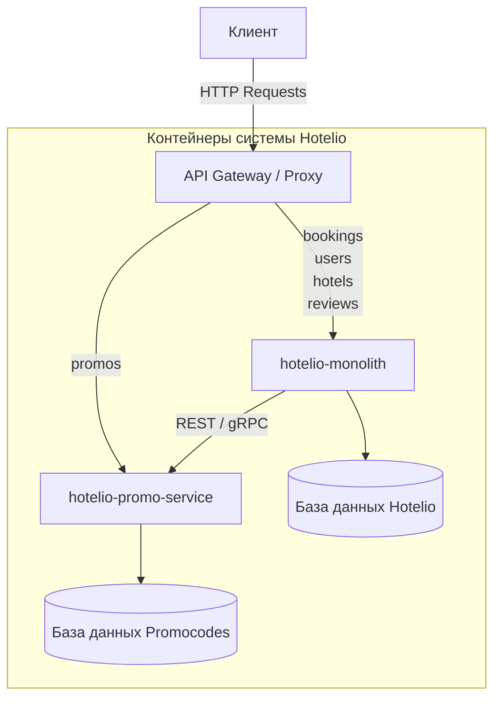

# Архитектурное решение (ADR): Миграция монолита Hotelio на микросервисы

**Название задачи:** Выделение первого микросервиса из монолита онлайн-платформы Hotelio (Паттерн Strangler Fig)  
**Автор:** Лобанов Павел  
**Дата:** 29.06.2026

---

## Бизнес-контекст

**Hotelio** — это онлайн-платформа для бронирования отелей и апартаментов. С ростом пользовательской базы и увеличением количества транзакций текущее монолитное Java-приложение стало ограничивать развитие бизнеса, замедляя выпуск новых фич и усложняя масштабирование независимых доменов. Настоящий документ описывает стратегию поэтапного перехода платформы на микросервисную архитектуру.

---

## Существующие проблемы монолита

1. **Связанность кода и данных:** Изменения в логике одного модуля требуют понимания всей системы, а сильная зацепленность мешает изолированной разработке фич.
2. **Ограничения масштабирования:** Невозможно изолированно масштабировать высоконагруженные домены отдельно от остального тяжелого монолита.
3. **Риски при релизах:** Высокая связанность кода приводит к рискам сломать смежный функционал при выкатке обновлений. Тестирование требует проверки всех зависимостей.

---

## Функциональные требования

Ниже приведены сценарии взаимодействия (Use Cases) на уровне API, за которые теперь будет отвечать выделенный микросервис:

| № | Действующие лица или системы | Use Case | Описание |
|---|---|---|---|
| 1 | Клиент | Проверка применимости промокода | Передача строки промокода для проверки его активности, срока действия и ограничений. |
| 2 | Сервис `PromoCodeService` | Автоматическая валидация условий | Компонент вычисляет доступность промокода для конкретного идентификатора пользователя. |
| 3 | Сервис бронирования (`BookingService`) | Расчет финальной стоимости заказа | Смежный модуль запрашивает актуальный размер скидки по коду, чтобы рассчитать итоговую сумму к оплате перед созданием брони. |

---

## Нефункциональные требования

Архитектурно значимые требования и ограничения для проектируемого решения:

| № | Требование | Описание |
|---|---|---|
| 1 | **Отказоустойчивость** | Сбой в работе функционала промокодов или маркетинговых акций не должен блокировать основные процессы поиска отелей и авторизации пользователей на платформе. |
| 2 | **Масштабируемость** | Возможность изолированно масштабировать сервис промокодов в периоды пиковых нагрузок (праздники, сезонные распродажи) отдельно от тяжелого монолита. |
| 3 | **Разделение баз данных** | Переход к выделенной базе данных для сервиса промокодов. Это устраняет конкуренцию за ресурсы БД между модулями, позволяет независимо масштабировать хранилище и исключает риск непредсказуемого воздействия на остальную систему при изменении схемы данных промокодов|

---

## Решение

Для реализации миграции выбран паттерн **Strangler Fig**. В качестве первого кандидата для выноса определен модуль **PromoCodeService (Управление промокодами)**. 

Модуль промокодов является автономным и использует только одну таблицу `promo_code`. Выносить его безопаснее всего, потому что он слабо связан с другими частями приложения и не участвует в сложных процессах (в отличие от сервиса бронирования). На этом небольшом модуле команде будет проще всего настроить и протестировать новую инфраструктуру, Docker-контейнеры и шлюз для управления трафиком без риска сломать всю систему.

Маршрутизация входящего трафика организуется на внешнем шлюзе (API Gateway). Запросы к эндпоинтам промокодов перенаправляются на новый микросервис, остальные проксируются в монолит.

### Диаграмма контекста и контейнеров (Модель C4)

---

## План миграции (Strangler Fig)

* **Этап 1: Развертывание прокси-слоя**
  Развертывание API Gateway перед монолитом. На данном этапе 100% трафика проксируется в `hotelio-monolith`.
* **Этап 2: Создание микросервиса `PromoCodeService`**
  Вынос бизнес-логики в отдельное приложение со своей изолированной базой данных.
* **Этап 3: Переключение маршрутов на шлюзе**
  Перенаправление запросов по пути `/api/promos` со шлюза на новый микросервис. Монолит начинает ходить в новый сервис через сетевые запросы для расчета скидки по промокоду при оформлении бронирования.
* **Этап 4: Очистка монолита**
  Полное удаление старого кода промокодов из монолита после стабилизации работы под нагрузкой.

---

## Альтернативы

### Вынос модуля Бронирования (BookingService) на первом этапе
* **Описание:** Начать миграцию с выноса ключевого транзакционного ядра системы.
* **Почему отвергнуто:** `BookingService` обладает максимальной связанностью со всеми модулями (`UserService`, `HotelService`, `PromoCodeService`, `ReviewService`) и таблицами БД. Попытка вынести его первым приведет к созданию распределенного монолита и создаст критические риски для стабильности основного бизнес-процесса компании.

---

## Недостатки, ограничения, риски

* **Сетевые задержки:** Межсервисные вызовы между монолитом и новым сервисом промокодов при оформлении бронирования увеличивают общее время ответа.
* **Сложность инфраструктуры:** Требуется развертывание, мониторинг и поддержка дополнительного слоя маршрутизации (API Gateway) и отдельного экземпляра базы данных.
* **Миграция данных:** Необходимость аккуратного переноса таблицы `promo_code` из общей БД монолита в изолированную базу нового сервиса без остановки обслуживания клиентов платформы.
* **Риск каскадных сбоев:** Появление сетевой зависимости между монолитом и новым сервисом требует внедрения паттернов отказоустойчивости на следующих этапах миграции.

