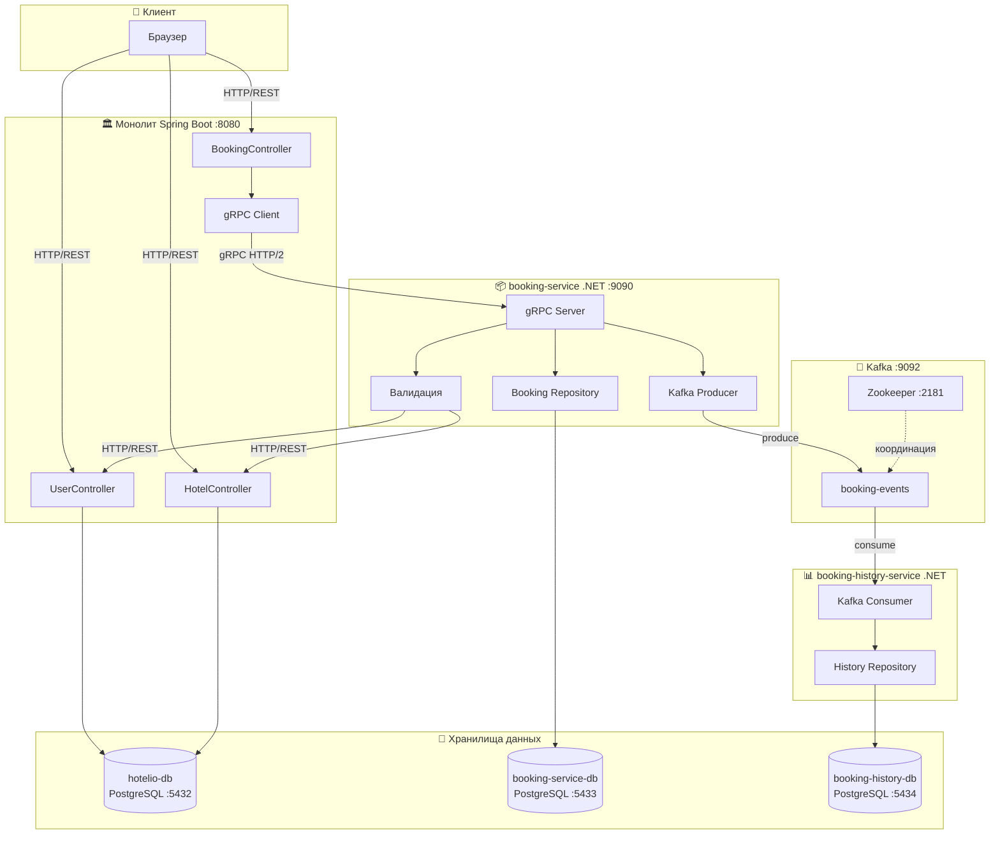
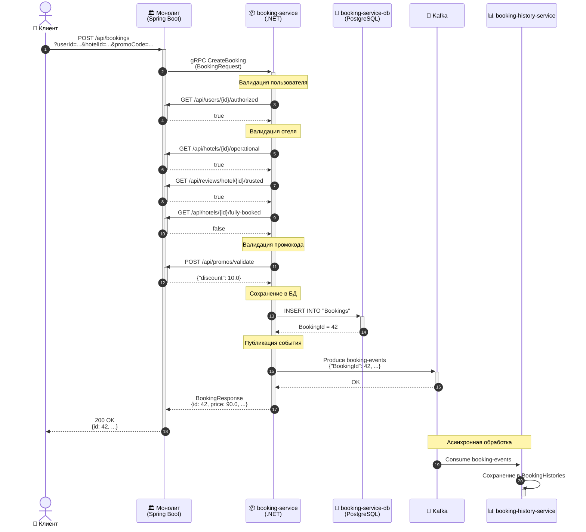
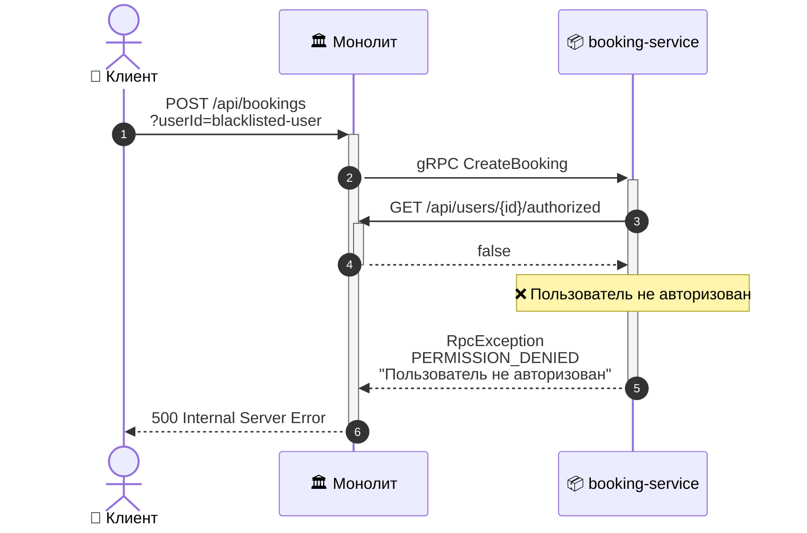
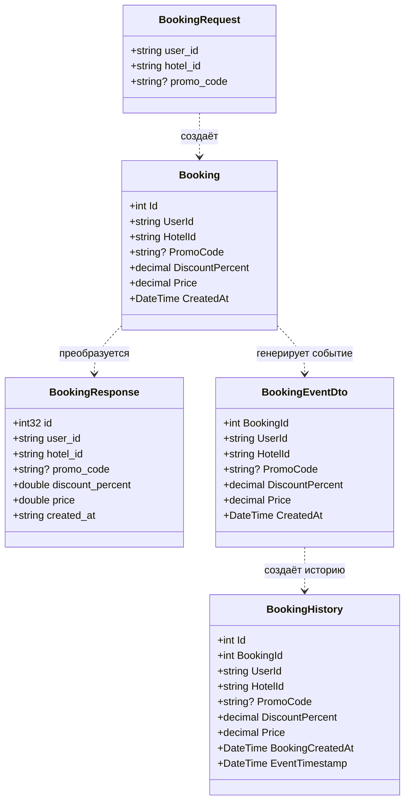
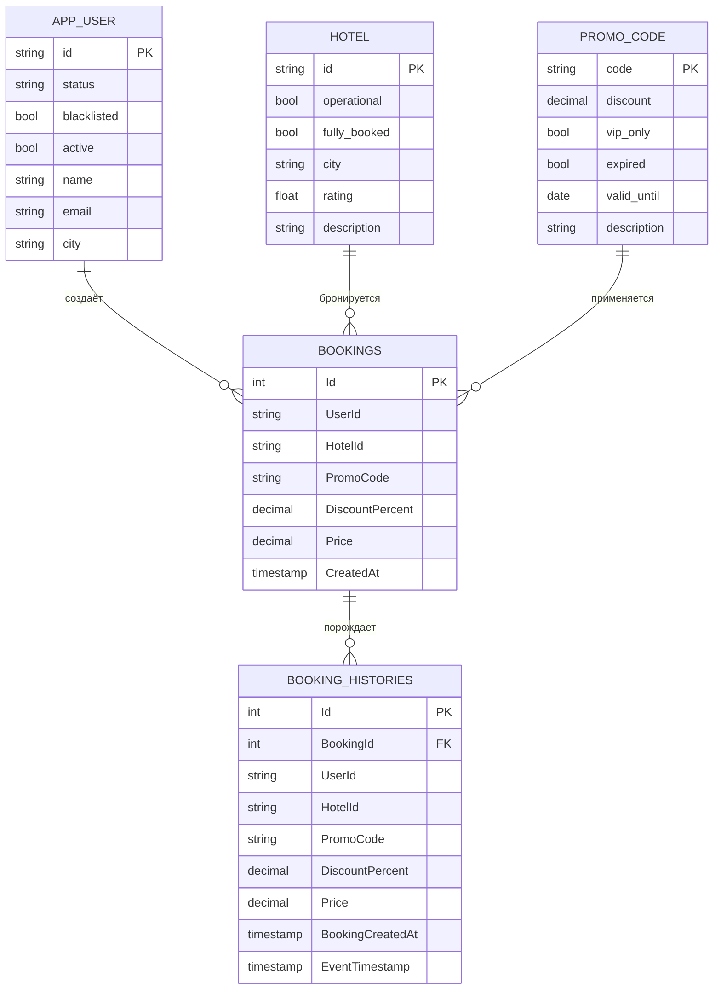
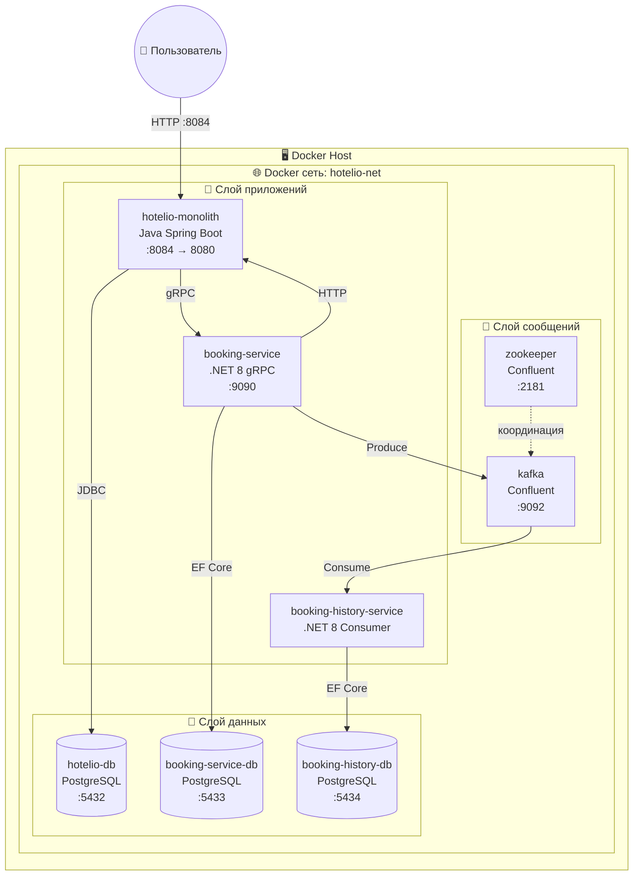
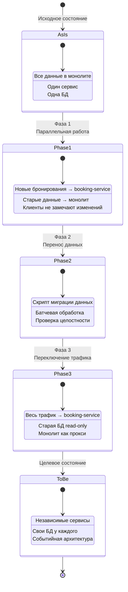
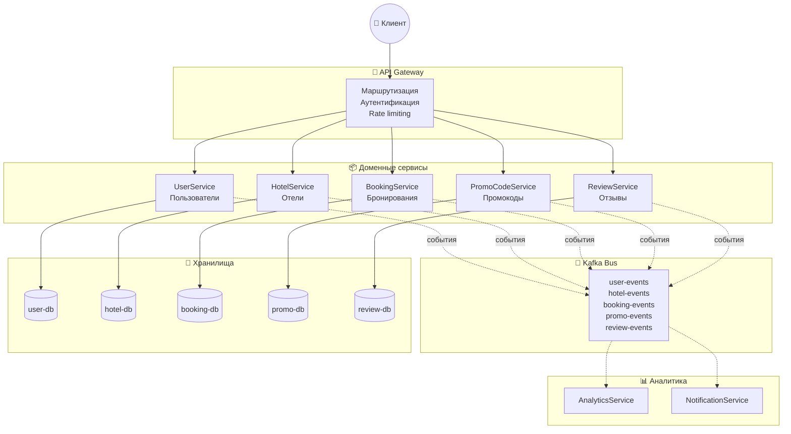

# 🏨 Задание 2: Миграция модуля бронирования на микросервисную архитектуру

> **Проект:** Hotelio — система бронирования отелей  
> **Паттерн миграции:** Strangler Fig (Душащий инжир)  
> **Дата выполнения:** Август 2026

---

## 📋 Содержание

1. [Обзор](#-обзор)
2. [Архитектура системы](#-архитектура-системы)
3. [Диаграмма последовательности](#-диаграмма-последовательности)
4. [Модель данных](#-модель-данных)
5. [Deployment Diagram](#-deployment-diagram)
6. [Стратегия миграции](#-стратегия-миграции)
7. [Стратегия To-Be](#-стратегия-to-be)
8. [Технологии](#-технологии)
9. [Запуск проекта](#-запуск-проекта)
10. [Артефакты](#-артефакты)

---

## 🎯 Обзор

В рамках задания реализована **постепенная миграция** модуля бронирования из монолитного приложения в отдельный микросервис. Клиенты продолжают работать с существующим API монолита, а внутренняя логика создания бронирований переключена на новый сервис `booking-service`.

### Ключевые принципы

- ✅ **Прозрачность для клиентов** — API не меняется
- ✅ **Постепенность** — миграция без остановки системы
- ✅ **Обратимость** — возможность отката на любом этапе
- ✅ **Асинхронность** — события обрабатываются через Kafka

---

## 🏗 Архитектура системы

### Component Diagram


### 🔄 Диаграмма последовательности
## Создание бронирования
🔄 Диаграмма последовательности


### Обработка ошибок

### 📊 Модель данных
## Class Diagram

### ER Diagram


### Deployment diagram


### Стратегия миграции
## State Diagram: Фазы миграции

### Strategy Diagram

```mermaid
graph LR
    subgraph AsIs["🔴 As-Is: Монолит"]
        A1[Одно приложение]
        A2[Одна БД]
        A3[Один язык]
        A4[Общий деплой]
    end
    
    subgraph Transition["🟡 Переходный период"]
        T1[Strangler Fig]
        T2[Параллельная работа]
        T3[Постепенный перенос]
    end
    
    subgraph ToBe["🟢 To-Be: Микросервисы"]
        B1[Независимые сервисы]
        B2[Свои БД]
        B3[Разные языки]
        B4[Независимый деплой]
        B5[Событийная архитектура]
    end
    
    AsIs --> Transition
    Transition --> ToBe
    
    style AsIs fill:#ffebee
    style Transition fill:#fff9c4
    style ToBe fill:#e8f5e9
```


### 🎯 Стратегия To-Be
## Целевая архитектура

# Сравнение архитектуры и технологический стек

## 📊 Сравнение As-Is и To-Be

| Аспект | As-Is (Монолит) | To-Be (Микросервисы) |
| :--- | :--- | :--- |
| **Архитектура** | Монолит | Микросервисы |
| **БД** | Одна общая | У каждого сервиса своя |
| **Деплой** | Всё сразу | Независимый |
| **Масштабирование** | Вертикальное | Горизонтальное |
| **Языки** | Только Java | Любой подходящий |
| **Отказоустойчивость** | Низкая | Высокая |
| **Сложность разработки** | Низкая initially | Выше initially |
| **Скорость выхода на рынок** | Медленно | Быстро |

---

## 🛠 Технологии

| Компонент | Технология | Версия | Назначение |
| :--- | :--- | :--- | :--- |
| **Монолит** | Java, Spring Boot | 3.x | API Gateway + валидация |
| **booking-service** | .NET, gRPC | 8.0 | Управление бронированиями |
| **booking-history-service** | .NET, Kafka Consumer | 8.0 | Аналитика бронирований |
| **Протокол** | gRPC (HTTP/2 + Protobuf) | 1.64+ | Межсервисное взаимодействие |
| **База данных** | PostgreSQL | 15 | Хранение данных |
| **ORM** | Entity Framework Core | 8.0 | Работа с БД |
| **Брокер сообщений** | Apache Kafka | 7.2.1 | Асинхронная коммуникация |
| **Координация** | Apache Zookeeper | 7.2.1 | Управление Kafka |
| **Оркестрация** | Docker Compose | 2.x | Развёртывание |

### 🚀 Запуск проекта
## Быстрый старт

```bash
# 1. Запуск всех сервисов
docker compose up -d --build

# 2. Ожидание инициализации (30-60 секунд)
sleep 30

# 3. Проверка статуса
docker ps
```

### Загрузка тестовых данных
```powershell
# Копирование фикстур
docker cp results/init-fixtures.sql hotelio-db:/tmp/init-fixtures.sql

# Выполнение SQL
docker exec -it hotelio-db psql -U hotelio -d hotelio -f /tmp/init-fixtures.sql
```

## Тестирование
```powershell
# Создание бронирования
curl.exe -X POST "http://localhost:8084/api/bookings?userId=test-user-2&hotelId=test-hotel-1&promoCode=TESTCODE1"

# Листинг через REST
curl.exe "http://localhost:8084/api/bookings?userId=test-user-2"

# Листинг через gRPC
'{"user_id": "test-user-2"}' | docker run -i --rm --network hotelio-net fullstorydev/grpcurl -plaintext -d '@' booking-service:9090 booking.BookingService/ListBookings
```

## 📁 Артефакты

| Файл | Описание |
| :--- | :--- |
| **docker-ps.log** | Вывод команды `docker ps` |
| **init-fixtures.sql** | Скрипт автоматической загрузки тестовых данных |
| **regress.ps1** | Скрипт запуска регрессионных тестов |
| **regress-output.log** | Подробные результаты выполнения автотестов |
| **test-log.txt** | Подробный лог сетевых запросов |
| **bookings-new-db.txt** | Срез данных из новой базы данных |
| **bookings-old-db.txt** | Срез данных из старой (исходной) базы данных |
| **booking-history.txt** | Срез данных из специализированной БД аналитики |
| **listing-comparison.txt** | Сравнительный анализ производительности REST и gRPC |
| **README.md** | Настоящий сопроводительный документ |

---

## ⚖️ Преимущества и риски

### ✅ Преимущества миграции

| Преимущество | Описание |
| :--- | :--- |
| **Независимое развёртывание** | Сервис `booking-service` обновляется отдельно без перезапуска основного монолита. |
| **Масштабируемость** | Возможность точечно масштабировать только наиболее нагруженные сервисы системы. |
| **Отказоустойчивость** | Внезапное падение одного изолированного сервиса не приводит к отказу всей системы. |
| **Технологическая гибкость** | Использование оптимальных языков программирования и фреймворков под конкретные задачи. |
| **Постепенность** | Перенос функционала шаг за шагом, исключающий необходимость переписывать всё приложение сразу. |
| **Обратимость** | Безопасная возможность быстрого отката изменений на любом этапе процесса миграции. |

### ⚠️ Риски и их митигация

| Риск | Митигация |
| :--- | :--- |
| **Сложность отладки** | Внедрение систем централизованного логирования и сквозной трассировки запросов. |
| **Сетевые задержки** | Использование высокопроизводительного gRPC вместо классического REST, оптимизация кэширования. |
| **Консистентность данных** | Реализация паттернов событийной архитектуры и координации распределенных транзакций (Саги). |
| **Отказ сервиса** | Внедрение паттерна Circuit Breaker (предохранитель) и настройка политик повторных запросов (Retry). |
| **Сложность развёртывания** | Автоматизация среды окружения с помощью Docker Compose и настройка пайплайнов CI/CD. |
| **Мониторинг** | Развертывание связки Prometheus и Grafana для непрерывного отслеживания метрик и алертинга. |
